# A Place Beyond — PS Vita edition (test build)

A dark, hand-painted action adventure, ported natively to the **PS Vita** from the web game *A Place Beyond*.

Walk the forest road to Blackwater Parish, row the drowned lake, light the lanterns of the Mire, hunt the Vesper Count
through the city, wake the Pale Bell — then take the five journeys beyond: the dive down the pistol's muzzle, the
climb, the night drive over the pass, the dragon's dream, and the Underparish.

> **This is a test build.** Thanks to the testers' logs, test builds 2 to 6 fixed the colours, the fog, the geometry,
> the menus, the HUD, the sprites and the lake. Test builds 7 and 8 brought it to 30 fps on real Vitas and added
> aiming with two sticks; test build 11 removed the boxes around the characters, test build 12 added a frame capture
> (four fingers on the screen), test build 13 fixed a freeze after 18 minutes, and **test build 21** is the current state: no black blinking and no boxes; an enemy can still vanish for a single frame now and then (test build 20's start-up measurement traced that to the console's paletted texture reads; the fix waits for a console on my desk).
> If you have a Vita with HENkaku, please try it and tell me how it runs:
> [open a hardware report](../../issues/new?template=hardware-report.md). Thank you!

### ⬇️ [Download test build 21](../../releases/tag/v0.12-test21)

Looking for the PSP version? → [A Place Beyond — PSP edition](https://github.com/bcaa777/a-place-beyond-psp)

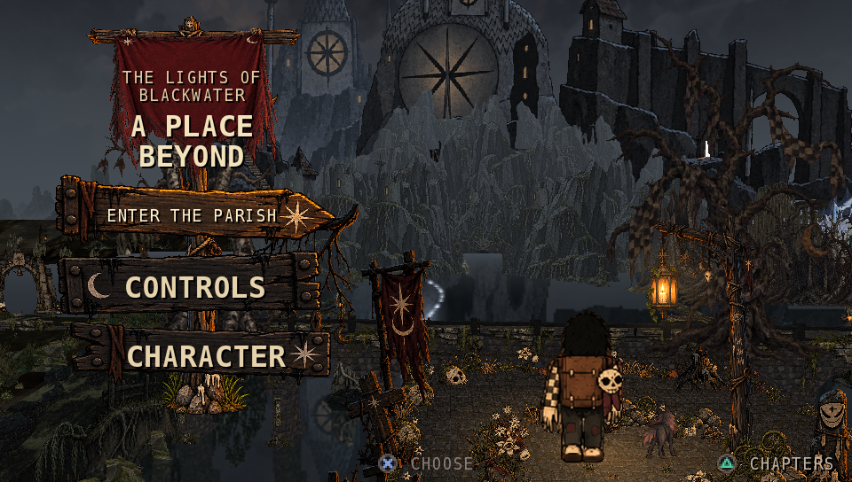

| | |
|---|---|
| 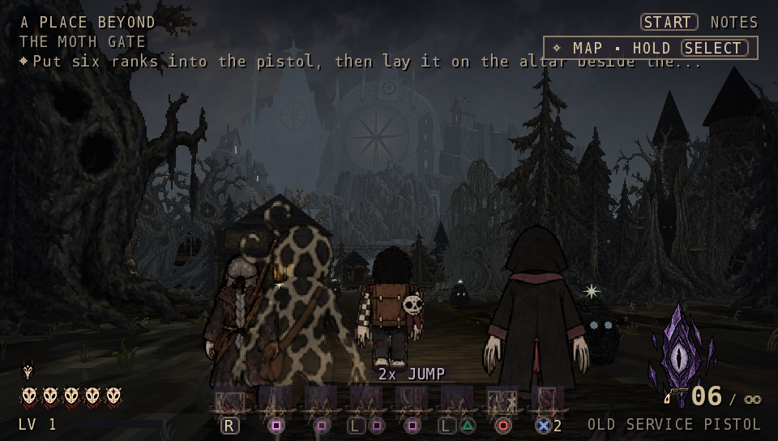 | 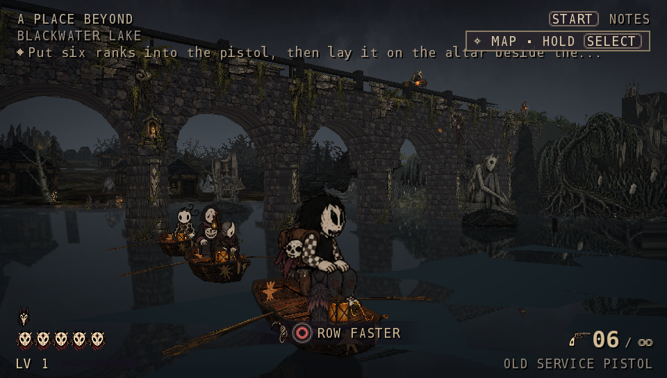 |
| 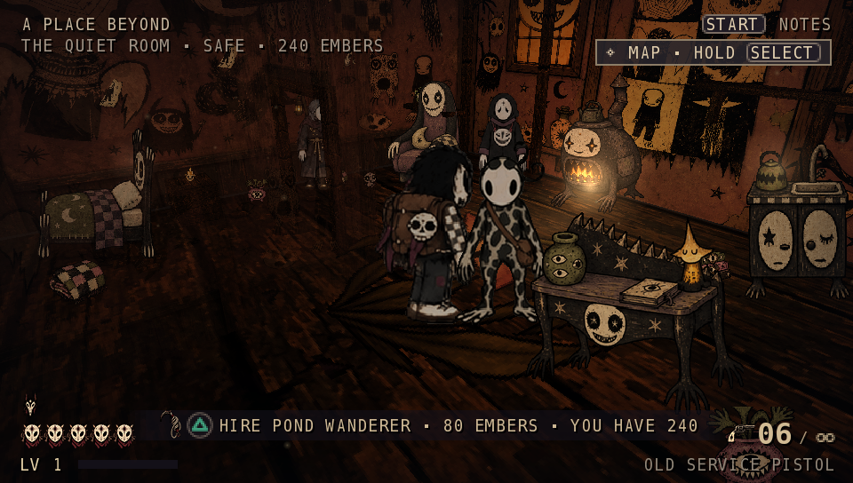 | 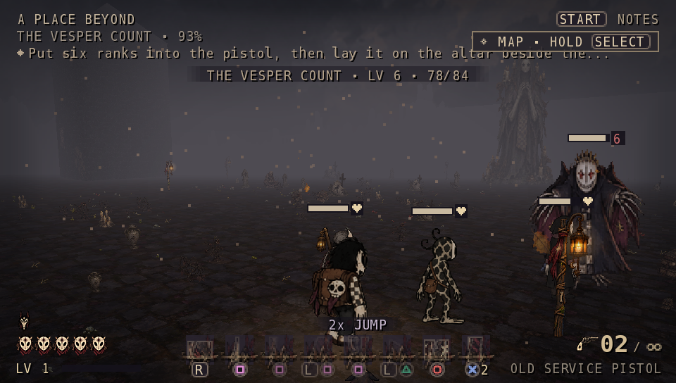 |
| 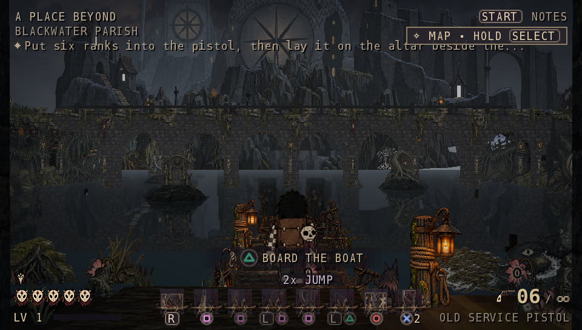 | 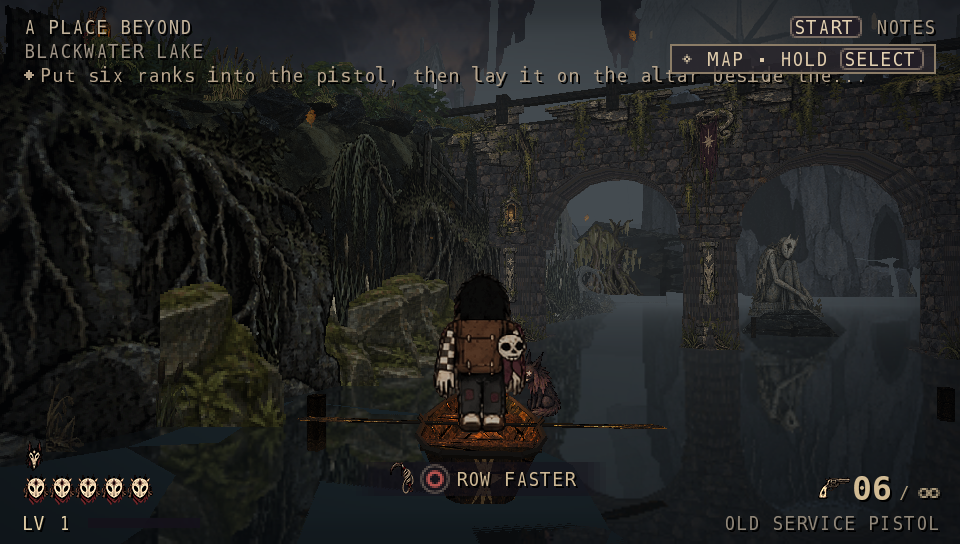 |
| 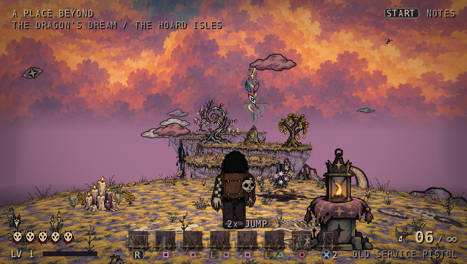 | 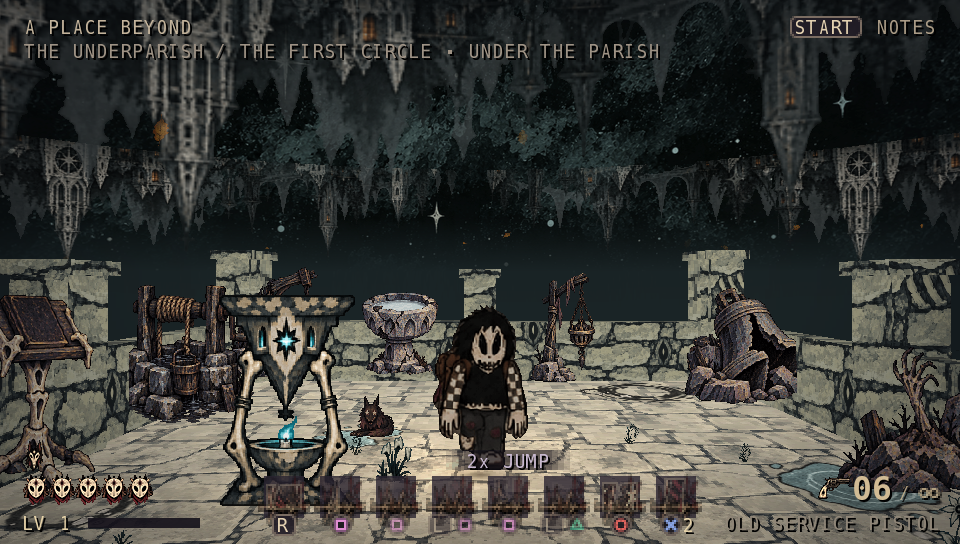 |
| 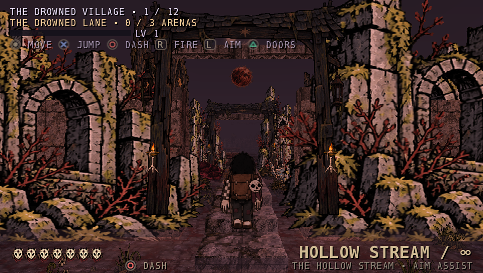 | 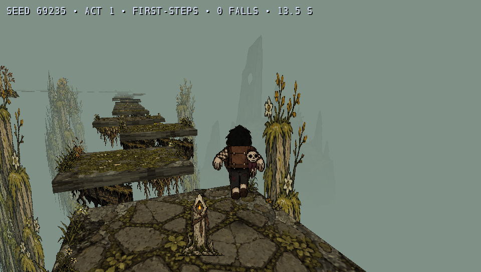 |
| 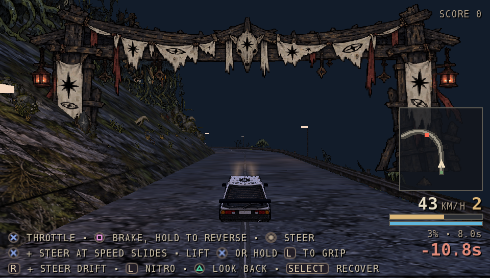 | 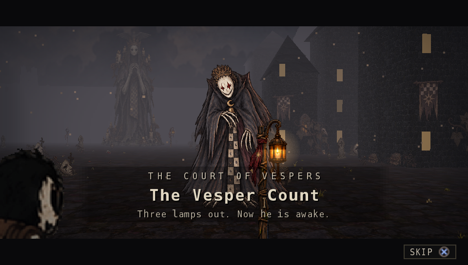 |
| 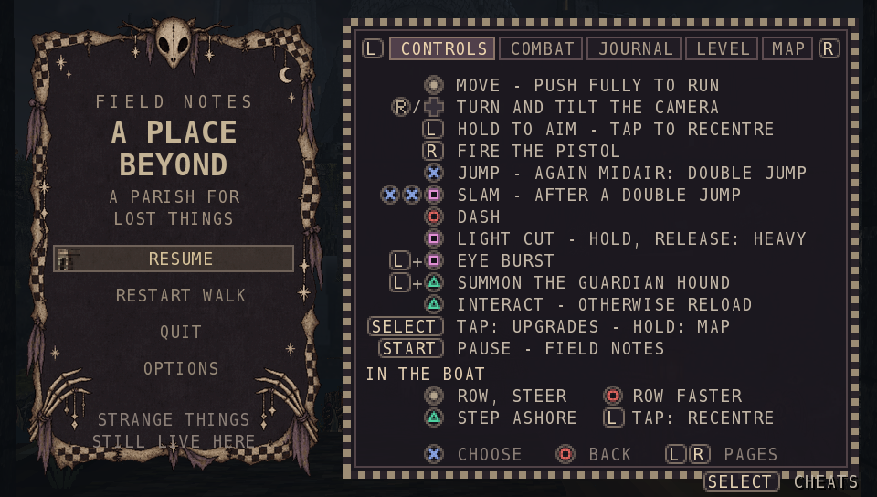 | |

## What's different from the PSP edition

- **Native 960x544** (not the PSP version under Adrenaline): the 3D draws at the Vita's full resolution.
- **Sharper art**: the hand-painted sprites, tiles and title art converted again from the originals at 2x
  (4x for the title, the boss intro cards and the ground), with mipmaps.
- **HUD and menus at 2x** with crisp text.
- **The companions**: three others wait in the Quiet Room. Hire them for embers; they follow you, fight beside you,
  fall and can be raised (hold △ beside them), and row after you in their own boats. (The PSP had no memory for them.)
- **Right stick camera** (the D-pad still works).
- **Stage four sees as far as the web version** (300 m; the PSP halves it).
- Sound effects at their full sample rate, music at a higher bitrate.
- **Saves move between the editions**: the same `save.bin` format as the PSP edition.

Everything else is the PSP edition v0.12: the whole open world of stage one, the five journeys, the dream, the
Underparish, the bosses and their intros, letters, the journal, the map, the upgrade tree and four playable characters.

## Requirements

- A **PS Vita or PS TV** that runs homebrew (HENkaku / Enso), and **VitaShell**.
- **Enable unsafe homebrew** in HENkaku Settings.
- About **450 MB** free on `ux0:`.
- Nothing else: no `libshacccg.suprx` or other extracted system files are needed.

## Install

1. Download the newest test build zip (`A-Place-Beyond-Vita-v0.12-test21.zip`) from [Releases](../../releases) and unzip it on your computer.
2. Copy `APlaceBeyond.vpk` to the Vita (e.g. `ux0:data/`, over USB or FTP in VitaShell).
3. In VitaShell, open the VPK and choose **Install**. The bubble *A Place Beyond* appears on the LiveArea.
4. Delete the VPK afterwards to free the space.

**Saves** are in `ux0:data/APlaceBeyond/save.bin`. To bring your PSP progress over, copy the PSP edition's
`PSP/GAME/APlaceBeyond/data/save.bin` (under Adrenaline: `ux0:pspemu/PSP/GAME/APlaceBeyond/data/save.bin`) to
`ux0:data/APlaceBeyond/save.bin`. Back it up first.

## If it crashes, freezes or runs slowly — the boot-log build

The release also has `APlaceBeyond-bootlog.vpk`: the same game, which writes what it does to
`ux0:data/APlaceBeyond/boot.txt` (line by line, so the file survives a crash). Install it over the normal one (your
save is kept), reproduce the problem, then attach `boot.txt` to a [hardware report](../../issues/new?template=hardware-report.md).
It also records the frame times, which is exactly what I can't measure without a real Vita.

## Controls

| Button | Action |
|---|---|
| Left stick | Move (push fully to run) |
| Right stick / D-pad | Turn and tilt the camera |
| R / hold L | Fire the pistol / aim over the shoulder: the right stick aims, the left stick walks (tap L recentres the camera) |
| ✕ | Jump, double jump; hold in the air to glide (once you have the wings) |
| ○ | Dash |
| □ | Light cut; hold for the heavy cut · L + □: eye burst · in the air after a double jump: ground slam |
| △ | Interact, board the boat, reload, raise a fallen companion (hold) · L + △: call the guardian hound |
| Select / hold Select | Upgrade tree / map |
| Start | Pause: journal, options, map |

On the title screen, △ opens **CHAPTERS** to jump straight into the journey stages, the dream or the Underparish.
The zip includes a cheat menu (`CHEATS.txt`) for anyone who just wants to look around.

## Known issues (test build)

- **Speed on real hardware**: the title screen, the parish and the lake run at 15-20 fps; the forest and the frost at
  30 in test build 6; test builds 7 to 10 are the speed fixes. Entering a new area may stutter for a moment the first
  time. Reports very welcome.
- 30 fps, as on the PSP (some journeys step their simulation once per frame).
- The companions and their boats don't show in the lake's reflection.
- The first trip into the Underparish shows a short black screen while it is built.
- If it looks dark, raise BRIGHTNESS in the pause menu's OPTIONS.

## Credits & license

*A Place Beyond* — game, art and design: **bcaa777**.
Hardware testing of the PS Vita edition: **Thub10**, who ran twenty test builds on a real Vita and sent the logs and
captures that fixed the colours, the geometry, the sprites, the freeze and the blinking. Thank you!
The PS Vita edition is built with the open [VitaSDK](https://vitasdk.org) toolchain; its GPU shaders were compiled
with [open-shacccg](https://github.com/frangarcj/open-shacccg). Third-party notices are in the release zip
(`THIRD_PARTY_NOTICES.txt` and `licenses/`). No GPL/LGPL code is in the game.

Please share the link to this page rather than re-uploading the files.
